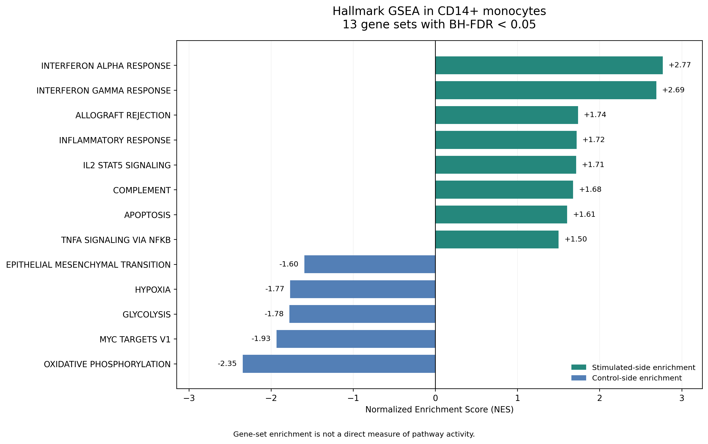
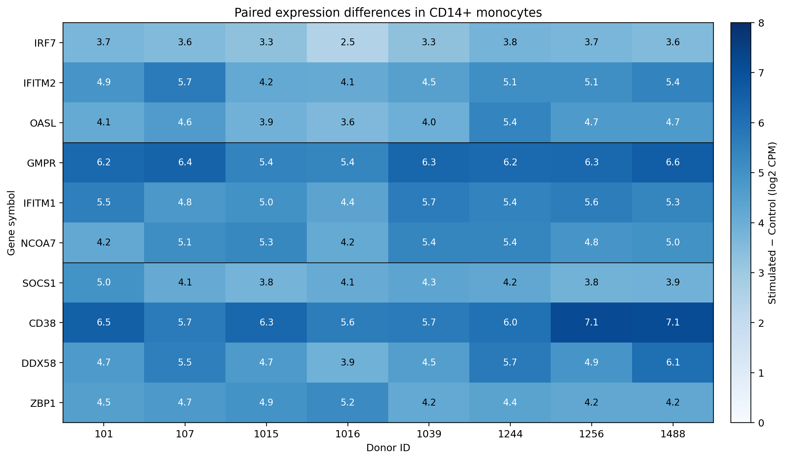
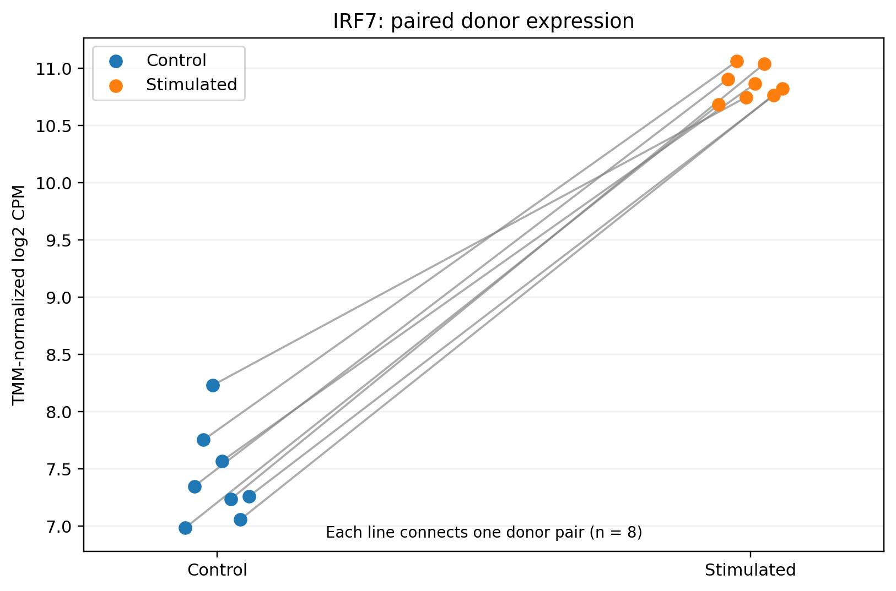

# Donor-aware analysis of IFN-β-associated transcription in CD14+ monocytes

Which transcriptional signatures distinguish IFN-β-stimulated and control CD14+ monocytes, and how consistent are they across donors? This project reanalyzes single-cell RNA-seq from eight paired donors. It validates source counts and cell identities, fits a paired pseudobulk differential expression model, and examines Hallmark enrichment and donor-level expression.

## Data and design

The analysis uses batch 2 of [GSE96583](https://www.ncbi.nlm.nih.gov/geo/query/acc.cgi?acc=GSE96583) from [Kang et al. (2018)](https://www.nature.com/articles/nbt.4042). Peripheral blood mononuclear cells from eight donors with lupus were profiled after six hours in control (GSM2560248) and IFN-β-stimulated (GSM2560249) conditions. Source cell-type labels and demuxlet singlet assignments identify the CD14+ cohort.

The donor is the biological replicate. For each donor and condition, raw UMI counts from retained cells are summed into one **pseudobulk** sample. This yields 16 samples and lets the model estimate the stimulated-versus-control contrast within donor pairs.

## Workflow

| Stage | Notebook | What it checks |
| --- | --- | --- |
| 01 | [Source validation](notebooks/01-ifnb-data-access.ipynb) | Verifies six GEO archives and aligns count columns to 29,065 source barcodes. |
| 02 | [AnnData construction](notebooks/02-ifnb-anndata.ipynb) | Preserves sparse integer counts, cell metadata and 35,635 Ensembl gene IDs through an H5AD round trip. |
| 03 | [Cell QC](notebooks/03-ifnb-qc.ipynb) | Audits counts and detection by donor and condition. Retains 5,357 CD14+ singlets with more than 100 detected genes and less than 90% hemoglobin-associated UMIs. |
| 04 | [Pseudobulk](notebooks/04-ifnb-pseudobulk.ipynb) | Aggregates raw counts by donor and condition, checks count conservation, and filters low-expression genes. |
| 05 | [Paired differential expression](notebooks/05-ifnb-paired-de.ipynb) | Verifies gene filtering against edgeR, applies TMM normalization, and fits a robust quasi-likelihood model with `~ donor_id + condition`. |
| 06 | [Hallmark enrichment](notebooks/06-ifnb-pathway.ipynb) | Runs preranked fgsea against MSigDB Hallmark 2026.1.Hs and examines leading-edge genes, donor-level expression and robustness. |

## Results

- **2,502 of 3,697 genes** passed Benjamini–Hochberg FDR < 0.05. In the stimulated-versus-control contrast, 1,250 had positive log₂ fold changes and 1,252 had negative log₂ fold changes. [Full DE table](results/differential_expression.tsv)
- **13 of 41 eligible Hallmarks** passed BH-FDR < 0.05. Interferon Alpha Response (NES +2.768) and Interferon Gamma Response (+2.690) were the strongest positive signatures. Oxidative Phosphorylation (−2.346) and Glycolysis (−1.777) were enriched toward the control end of the gene ranking. [GSEA table](results/hallmark_gsea.tsv) · [Coverage of all 50 Hallmarks](results/hallmark_coverage.tsv)
- The two interferon signatures shared 60 leading-edge genes. All **135 unique leading-edge genes** had higher TMM-normalized log₂ CPM in stimulated samples in each of the eight donor pairs. Leading-edge genes are the subset that drives a gene set’s enrichment score. [Donor summary](results/donor_expression_summary.tsv.gz) · [Paired values](results/donor_expression_pairs.tsv.gz)
- All 2,502 primary DE genes retained their direction in eight leave-one-donor-out refits. Of these, 2,161 also retained FDR < 0.05 across all refits. Relaxing the hemoglobin threshold to 95% added three cells and retained 2,501 of the 2,502 primary FDR calls, with zero sign reversals among primary DE genes. [Donor omission results](results/lodo_by_donor.tsv) · [QC sensitivity summary](results/qc95_sensitivity.json)

### Selected figures

*Normalized enrichment scores (NES) for the 13 Hallmarks at BH-FDR < 0.05. Positive values place a signature toward the stimulated end of the ranking.*

*Stimulated minus control TMM-normalized log₂ CPM for ten representative interferon leading-edge genes. Each column is a donor and the color scale is shared across genes.*

*TMM-normalized IRF7 expression by condition. Lines connect the two samples from each donor.*

## Reproduce the workflow

Run notebooks 01–06 in Kaggle CPU sessions, starting from the GEO supplements downloaded by Stage 01. Use the preceding notebooks’ saved outputs as inputs according to the [runtime and checkpoint guide](docs/reproducibility.md). The archived runs use Python 3.13 and R 4.6.1 with edgeR 4.10.7 and fgsea 1.38.0. The [SHA-256 manifest](docs/checksums.sha256) verifies the bundled results and figures.

## Limitations

Control and stimulated cells came from separate pooled captures. Condition and capture are perfectly confounded, and donor pairing cannot isolate an IFN-β effect from capture differences. The cohort includes eight donors and uses the study’s cell labels. Donor-level agreement, donor omission and QC sensitivity all use the same dataset. Enrichment describes transcript ranks and provides no direct measurement of protein activity or metabolic flux.

[Study, data and methods references](docs/references.md)
